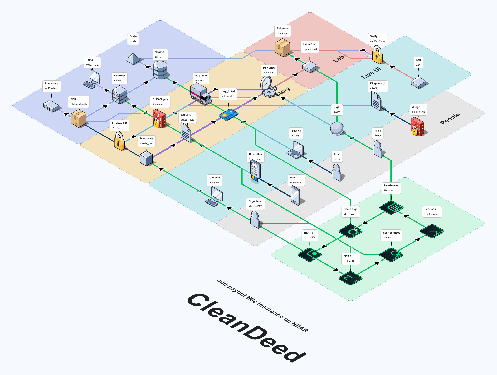
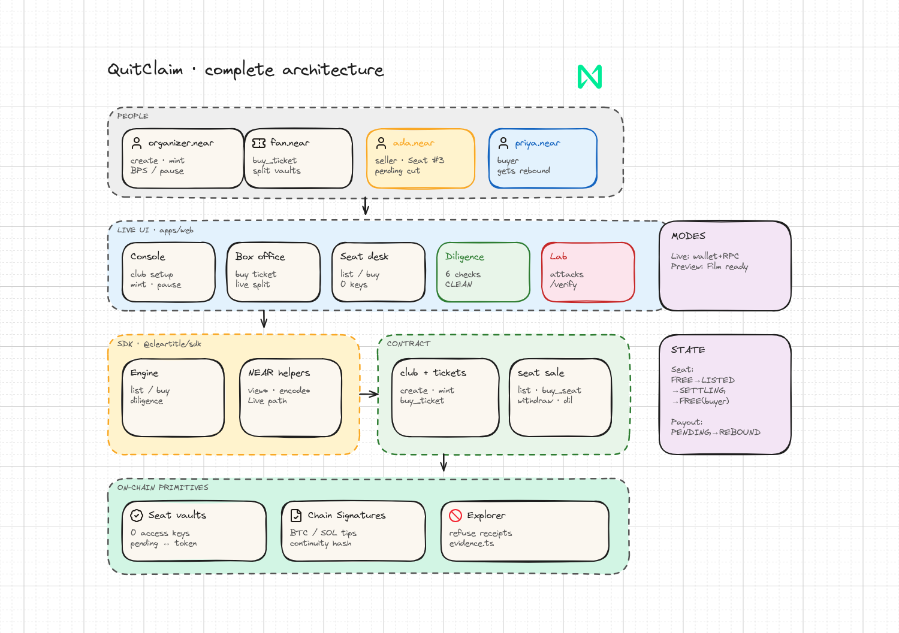
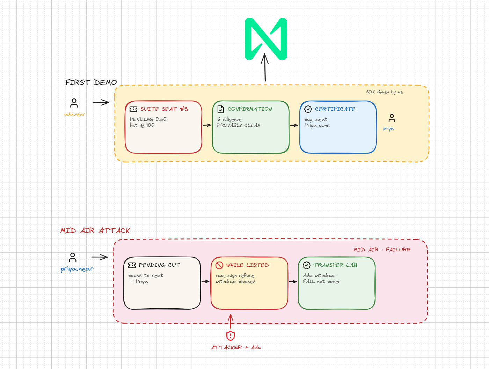

# Diagrams

## FossFLOW



| File | Role |
| --- | --- |
| `fossflow-e2e.json` | Full E2E model |
| `fossflow-architecture.json` | Compact stack |
| `fossflow-userflow.json` | Compact mid-payout |

```bash
node scripts/generate-fossflow-e2e.mjs
```

## Excalidraw





| File | Role |
| --- | --- |
| `quitclaim-architecture.excalidraw` · `.png` | Full stack |
| `ada-priya-architecture.excalidraw` · `.png` | Clear-title sale + mid-air fail |

```bash
node scripts/capture-excalidraw.mjs
```
